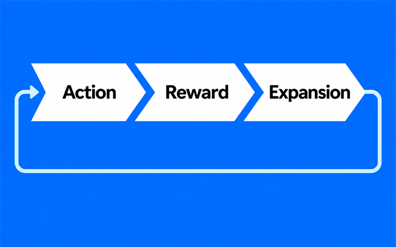
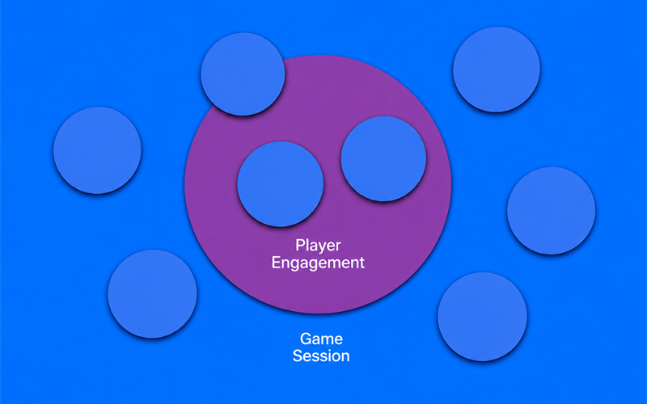

# Bitcoin for game development

> Watch the full presentation: [Blockchain 3: Bitcoin For Game Development](https://www.youtube.com/watch?v=-hZ7I68h7BI)

## 1. Design around the right Bitcoin layer

- Bitcoin Layer 1 gives a game a durable settlement layer.
- Layer 2 systems can move value on the timescale of a game session.
- A game can keep ordinary moment-to-moment play off-chain and choose where an on-chain action matters.

The video makes a practical distinction: a game does not need to make every button press a Bitcoin transaction. Layer 1 can handle the actions that need Bitcoin's settlement guarantees, while a compatible Layer 2 can support fast transfers, in-game currency, items, and contracts. That lets a developer start with the player experience, then decide which actions deserve a blockchain record.

## 2. Make ownership part of the game design

- Players can earn an item through play, acquire it through a marketplace, or use both paths.
- An owned item can change gameplay, such as increasing a character's damage, rather than only changing its appearance.
- The game can remain playable without a blockchain login and unlock selected features after a player connects an account.

The useful question is not whether a game has NFTs or a wallet. It is what the player can do because of ownership. In the demo, a dagger gives its owner a 30 percent damage boost. The developer still controls whether that item is earned, purchased, traded, or some combination. Blockchain becomes one system in the game's economy, not the game itself.

## 3. Put the integration behind a game-facing service

- The sample game talks to the Blockchain Integration Service, or BIS, through an account menu rather than embedding wallet mechanics throughout the game.
- BIS provides account, payment, asset, marketplace, achievement, and contract features for the proof of concept.
- The demonstration uses Bitcoin test networks, not mainnet, and shows a wallet funding flow that completes in about a second.

This separation keeps the game focused on controls, combat, and feedback. The service handles account connections and value transfers, so the same integration can be reused by another web game. The result is a smaller place to reason about blockchain behavior and a clearer boundary between gameplay code and wallet or payment code.

## Explore the project

- [Watch the video](https://www.youtube.com/watch?v=-hZ7I68h7BI)
- [Stealth and Steel game repository](https://github.com/SamuelAsherRivello/blockchain-stealth-and-steel-game)
- [Blockchain Integration Service repository](https://github.com/SamuelAsherRivello/blockchain-integration-service)
